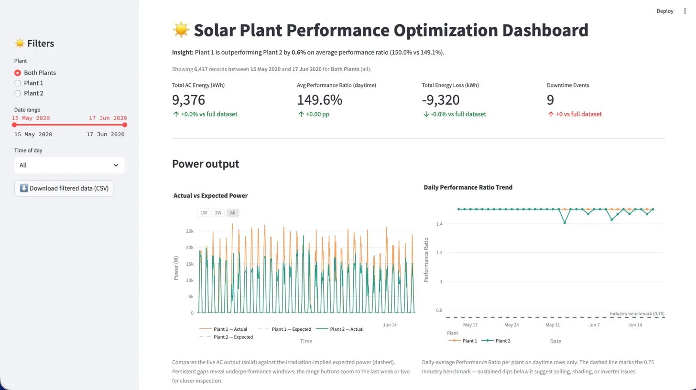
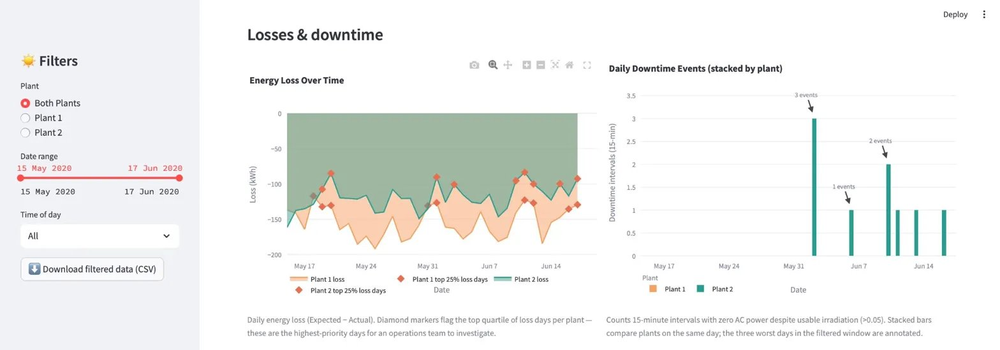
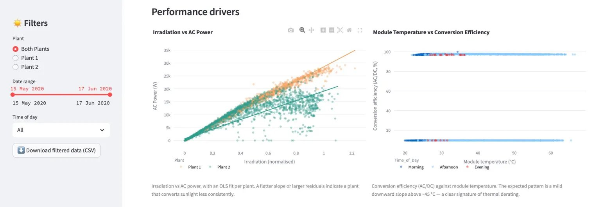
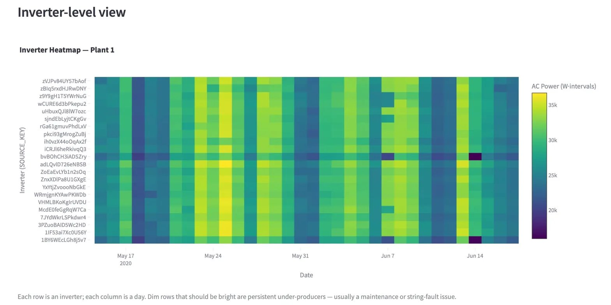
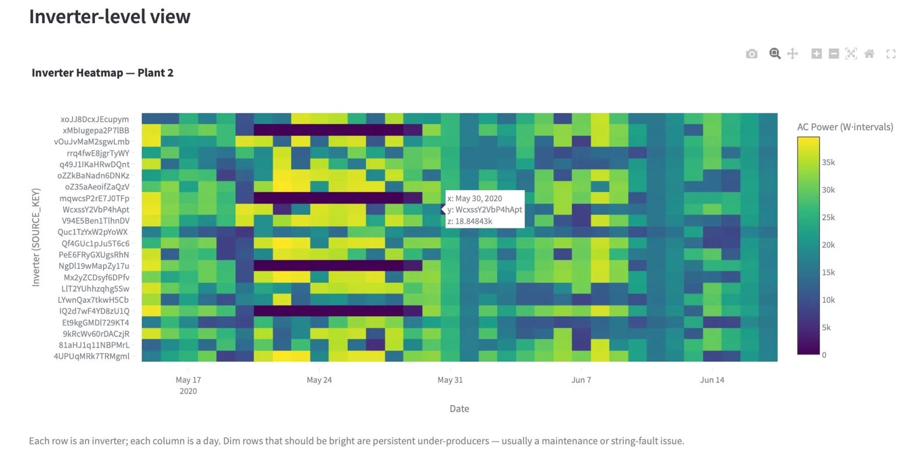

# ☀️ Solar Plant Performance Optimization Dashboard

An interactive analytics dashboard that helps solar plant operators monitor performance, spot underperforming inverters, and quantify energy losses — turning millions of raw sensor readings into a single screen of operational decisions.

Built with **Python**, **Streamlit**, and **Plotly**, the dashboard blends inverter-level generation data with plant-level weather telemetry to surface the day-to-day insights an O&M team actually uses.

---

## 📸 Screenshots

**Overview & KPIs**


**Losses & Downtime**


**Performance Drivers**


**Inverter Heatmap — Plant 1**


**Inverter Heatmap — Plant 2**


---

## 🎯 Business Problem

Solar plants rarely lose revenue from a single dramatic failure — they lose it slowly, through soiled panels, drifting inverters, mis-aligned strings, and afternoons where every panel runs hotter than spec.

For operators, the challenge isn't a lack of data. It's signal-to-noise. A 35-inverter plant generates millions of rows a year, and operations teams need a clear answer to four questions:

- Are we generating what we *should* be, given today's irradiation?
- Which inverters are persistently underperforming the fleet?
- How much energy did we leak this week, and on which days?
- Is thermal derating quietly eating into our afternoon yield?

---

## 💡 Solution Overview

A single-page Streamlit dashboard that ingests raw inverter and weather CSVs, engineers performance KPIs (Performance Ratio, Conversion Efficiency, Energy Loss, Downtime), and presents them across seven interactive charts driven by one filter bar.

The result: an O&M analyst can open the dashboard, filter to yesterday, and within 30 seconds know *which plant, which inverter, and which hour* needs attention.

---

## ✨ Key Features

- **Performance Ratio tracking** — actual vs expected power with a 0.75 industry benchmark line
- **Energy loss timeline** — daily losses with top-quartile loss days flagged automatically
- **Downtime detection** — captures intervals where output is zero *while the sun is up*
- **Inverter-level heatmap** — one row per inverter, one column per day; persistent under-producers stand out instantly
- **Thermal derating analysis** — module temperature vs conversion efficiency, coloured by time of day
- **Interactive filters** — plant selector, date range, time-of-day, and CSV export of the filtered view

---

## 📊 Dataset

| File | Rows | Granularity | Period |
|---|---|---|---|
| Plant 1 Generation | 68,778 | Per-inverter, 15 min | 15 May – 17 Jun 2020 |
| Plant 1 Weather | 3,182 | Plant-level, 15 min | 15 May – 17 Jun 2020 |
| Plant 2 Generation | 67,698 | Per-inverter, 15 min | 15 May – 17 Jun 2020 |
| Plant 2 Weather | 3,259 | Plant-level, 15 min | 15 May – 17 Jun 2020 |

**Source:** Solar Power Generation Data (Kaggle) — anonymised real-world plant data.

**Generation fields:** `DATE_TIME`, `PLANT_ID`, `SOURCE_KEY`, `DC_POWER`, `AC_POWER`, `DAILY_YIELD`, `TOTAL_YIELD`
**Weather fields:** `DATE_TIME`, `AMBIENT_TEMPERATURE`, `MODULE_TEMPERATURE`, `IRRADIATION`

---

## 🛠️ Tech Stack

| Layer | Tools |
|---|---|
| Language | Python 3.10+ |
| Data | pandas, NumPy |
| Dashboard | Streamlit |
| Visualisation | Plotly |
| Modelling | scikit-learn, statsmodels |

---

## 🚀 How to Run Locally

```bash
# 1. Clone the repository
git clone <repo-url>
cd solar_dashboard

# 2. Install dependencies
pip install -r requirements.txt

# 3. Launch the dashboard
streamlit run app.py
```

The app opens at `http://localhost:8501`. The four CSV files should sit in a `data/` folder next to `app.py`.

---

## 🔍 Key Insights

1. **Plant 1 outperforms Plant 2 on performance ratio** across the observation window — a small but persistent gap that compounds materially over a year of operations.

2. **Energy loss is concentrated on a handful of days.** The top-quartile loss markers cluster on specific dates rather than spreading evenly, meaning targeted root-cause investigation on those days has a far higher payoff than a uniform inspection schedule.

3. **Downtime happens during sunlight hours.** Both plants show zero-output intervals where irradiation is well above the daytime threshold — clear evidence of inverter or string-level faults rather than weather effects, and exactly the kind of pattern an automated alert should fire on.

4. **Thermal derating is real and visible.** Conversion efficiency holds steady through the morning and degrades as module temperatures climb past ~45 °C — a textbook signature that quantifies how much yield is lost to heat in the afternoon.

5. **A small number of inverters drag the fleet down.** The heatmap exposes inverters that are visibly dimmer than their peers across most of the month — these are the single most actionable findings for a maintenance team.

---

## 🔭 Future Improvements

- **Predictive maintenance** — train a per-inverter anomaly model on actual-vs-expected residuals to flag drifting inverters before they fail.
- **Live SCADA integration** — replace CSV ingestion with an OPC UA / Modbus stream and auto-refresh the dashboard.
- **Alerting layer** — push downtime and PR-below-threshold events to email / Slack / PagerDuty so operators don't need to be watching the screen.
- **24-hour AC power forecast** — overlay a short-horizon forecast on the actual-vs-expected chart using lagged irradiation and temperature features.
- **Calibrated PR baseline** — replace the nominal-efficiency proxy with measured nameplate capacity so PR sits in its natural 0.7–0.9 range.

---


*If you found this project useful, consider giving the repo a ⭐ — it helps others discover it.*
